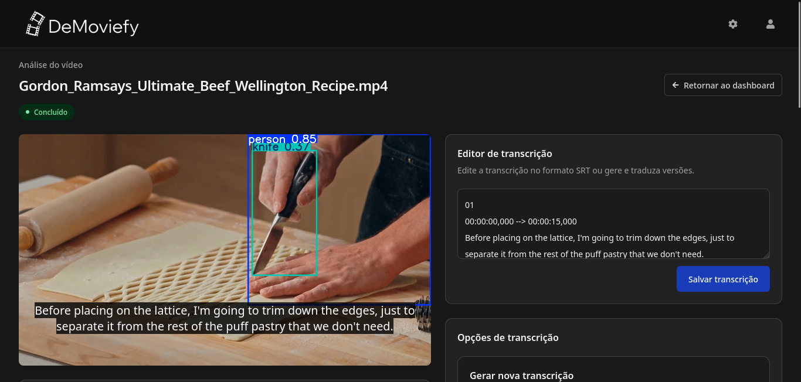

<p align="center">
  
</p>

# DeMoviefy


O DeMoviefy é uma plataforma automatizada e gratuita para análise, processamento e revisão de arquivos digitais de vídeo. O projeto foi desenvolvido para otimizar o fluxo de moderação de conteúdo em larga escala, integrando inteligência artificial e visão computacional de forma simples, acessível e sem burocracia.

<p align="center">
  
  <br>
  <sub>Fonte do vídeo utlizado: <a href="https://www.youtube.com/watch?v=f03Re9q-KDk">Nick's Kitchen</a></sub>
</p>


## O que é o projeto e suas funcionalidades

O DeMoviefy combina tecnologias avançadas de processamento de dados para extrair informações úteis de vídeos automaticamente. Suas principais funcionalidades incluem:

* Upload e gerenciamento de vídeos: envio simplificado de arquivos de vídeo através de uma interface intuitiva.
* Análise por inteligência artificial: processamento visual para detectar objetos, identificar conteúdos sensíveis (como armas) e categorizar o material.
* Transcrição automática de áudio: extração e conversão do áudio do vídeo em texto estruturado no formato SRT.
* Tradução local de legendas: suporte à tradução de legendas utilizando ferramentas locais para português, inglês e espanhol.
* Estimativa de classificação indicativa: sugestão automática de faixa etária e classificação com base nas normas do ministério da justiça e segurança pública (MJSP).

## Tecnologias utilizadas

O DeMoviefy combina modelos de IA com uma interface web e serviços que
processam os vídeos no computador:

- **Modelos de IA:** [YOLO, da Ultralytics](https://github.com/ultralytics/ultralytics), analisa os quadros do vídeo localmente para detectar objetos e outros elementos visuais.
- **Transcrição:** [OpenAI Whisper](https://github.com/openai/whisper) converte o áudio do vídeo em texto com marcações de tempo e oferece transcrição de alta precisão.
- **Tradução:** [Argos Translate](https://github.com/argosopentech/argos-translate) traduz as legendas localmente.

O frontend foi desenvolvido em [React](https://react.dev/) e o backend em [Flask](https://flask.palletsprojects.com/en/stable/).

## Instalar e iniciar o projeto

O launcher prepara automaticamente o ambiente virtual, instalando as dependências do projeto. Na primeira
execução, abra um terminal na pasta principal do projeto e rode:

```sh
python setup/main.py
```
Na janela que abrir, clique em **Setup
Environment** para instalar as dependências do frontend e do backend. 

Marque a opção **Instalar Pacotes de IA** para instalar os modelos de IA que transcrevem e analisam os vídeos. 

O launcher também oferece a instalação do [FFmpeg](https://www.ffmpeg.org/), usado na análise dos vídeos e extração de áudio.

Quando
a instalação terminar, clique em **Start All** para iniciar a aplicação.

### Requisitos do launcher

| Ferramenta | Versão recomendada                                      |
|------------|----------------------------------------------------------|
| Node.js    | LTS 20 ou superior, necessário para o frontend           |
| npm        | Incluso no Node.js                                       |
| Python     | Python 3                                                 |
| pip        | Incluso no Python; atualizado pelo launcher durante setup |

É necessário acesso à internet durante a instalação para baixar os componentes e
os modelos de tradução e IA. Essa etapa pode demorar, especialmente ao baixar os
modelos. 

### Configurar o reCAPTCHA

O cadastro de usuários oferece proteção com reCAPTCHA, que vem desativada por padrão. Para habilitá-la, gere
suas próprias chaves no [Google reCAPTCHA](https://developers.google.com/recaptcha/intro) e configure os arquivos `.env` disponíveis em `demoviefy-frontend/.env` e `demoviefy-backend/.env`.

Consulte o [guia completo do launcher](docs/LAUNCHER.md) para opções de setup,
serviços e solução de problemas.

## Execução manual

Se preferir não usar o launcher, consulte os seguintes arquivos:

- [Guia manual do frontend](demoviefy-frontend/README.md)
- [Guia manual do backend](demoviefy-backend/README.md)

